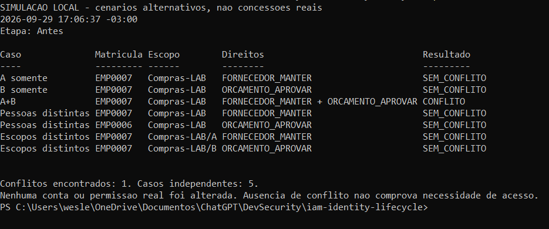
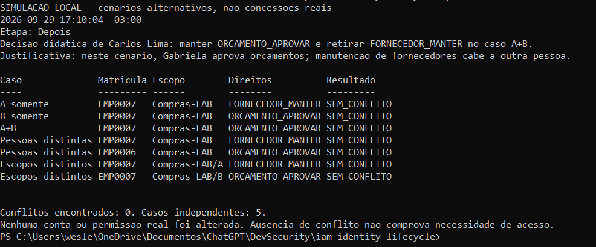

# SoD-001 — conflito tratado no modelo local

**Objetivo:** detectar e tratar uma combinação de direitos incompatíveis pela regra fictícia de Compras-LAB. Exercício executado em 29/09/2026, separado dos inventários AD/Entra. Leia regra → caso principal de Gabriela → decisão e depois. As tabelas abaixo são um resumo documental das capturas históricas, não uma nova execução; as imagens completas e os demais cenários ficam disponíveis para conferência.

## 1. Regra e motivo da separação

**SoD significa segregação de funções. Regra SoD-001:** a mesma pessoa não pode acumular os direitos A e B no mesmo escopo de Compras-LAB.

| Direito fictício | Significado no processo |
|---|---|
| A — `FORNECEDOR_MANTER` | Manter o cadastro de fornecedores. |
| B — `ORCAMENTO_APROVAR` | Aprovar orçamento. |

O risco considerado é concentrar a manutenção de fornecedores e a aprovação de orçamento na mesma pessoa. O cenário exige separar essas responsabilidades; esses direitos, sozinhos, não demonstram capacidade de executar pagamentos. A regra é específica deste modelo.

**Caso principal:** Gabriela (EMP0007), no escopo Compras-LAB, acumula A+B. A decisão simulada mantém sua aprovação de orçamento e retira a manutenção de fornecedores. As outras linhas das capturas são cenários alternativos para validar o comparador, não concessões adicionais à mesma pessoa neste caso.

## 2. Prova 15 — detectar o conflito

**29/09/2026, 17:06:37 UTC−03:00.** Resumo da linha **A+B** da prova 15:

| Pessoa / escopo | Direitos observados no modelo | Resultado |
|---|---|---|
| Gabriela — EMP0007 / Compras-LAB | Manter fornecedores **e** aprovar orçamento | **CONFLITO**: combinação proibida pela SoD-001. |

Conferir a captura original 15 — olhar somente a linha A+B

[Abrir a captura original 15](15-sod-antes.png).

## 3. Prova 16 — decisão e validação após o tratamento

**29/09/2026, 17:10:04 UTC−03:00.** A captura exibe a decisão didática atribuída a Carlos Lima: **manter B e retirar A do caso A+B**, pois Gabriela aprova orçamentos no cenário e a manutenção de fornecedores cabe a outra pessoa. A atribuição dessa função a outra pessoa não foi implementada neste exercício.

| Pessoa / escopo | Direito preservado | Direito retirado no modelo | Resultado |
|---|---|---|---|
| Gabriela — EMP0007 / Compras-LAB | Aprovar orçamento | Manter fornecedores | **SEM_CONFLITO** pela SoD-001. |

**Comparação:** no caso principal, a combinação passou de A+B para somente B. O total da execução passou de um para zero conflitos. O nome da linha **A+B** permanece no depois para identificar o cenário original; a coluna **Direitos** mostra o que restou.

Conferir a captura original 16 — decisão exibida e linha A+B somente com B

[Abrir a captura original 16](16-sod-depois.png).

## 4. Como o script compara e quais são os limites

O [script PowerShell](../../../05-automacao/Invoke-SoDLab.ps1) cria os direitos fictícios e agrupa por **caso, matrícula e escopo**. O caso separa as alternativas de validação; matrícula e escopo identificam a pessoa e o contexto. Dentro de cada conjunto, a presença simultânea de A e B produz conflito. Na etapa Depois, o script retira A do caso conflitante em memória e avalia novamente, preservando B. [Roteiro técnico](09-roteiro-sod.md).

Apoio técnico — por que as capturas têm cinco cenários e matrículas repetidas

| Cenário independente | Por que recebe esse resultado |
|---|---|
| A somente | Só mantém fornecedores; não acumula B. |
| B somente | Só aprova orçamento; não acumula A. |
| A+B — caso principal | Mesma matrícula e escopo com os dois direitos: conflito antes; somente B depois. |
| Pessoas distintas | Uma pessoa tem A e outra tem B: não acumulam os dois na mesma identidade. |
| Escopos distintos | A e B estão em escopos diferentes: sem conflito pela regra delimitada, que não avalia efeitos entre escopos. |

São alternativas de validação, não concessões simultâneas a Gabriela. Pessoas e escopos distintos ocupam duas linhas cada; por isso há sete linhas de resultado para cinco cenários. Os quatro casos de controle permanecem sem conflito antes e depois.

Cada execução recria os dados. As provas demonstram detecção e tratamento no modelo local, sem revogação em aplicação real. SoD estática: sem ERP, transações financeiras, API de concessão, prevenção implantada ou avaliação de conluio. A decisão é simulada, sem aprovação corporativa externa. `GG_FIN_READ` não concede esses direitos, e **zero conflitos não comprova necessidade de cada acesso**.

[Voltar ao índice por assunto](README.md).
