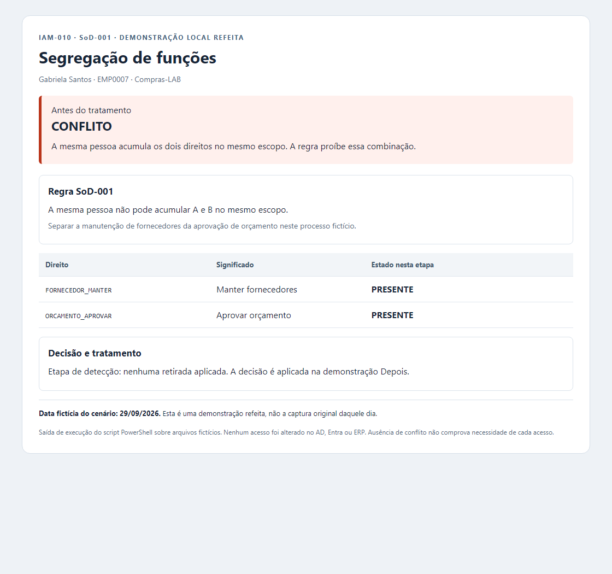
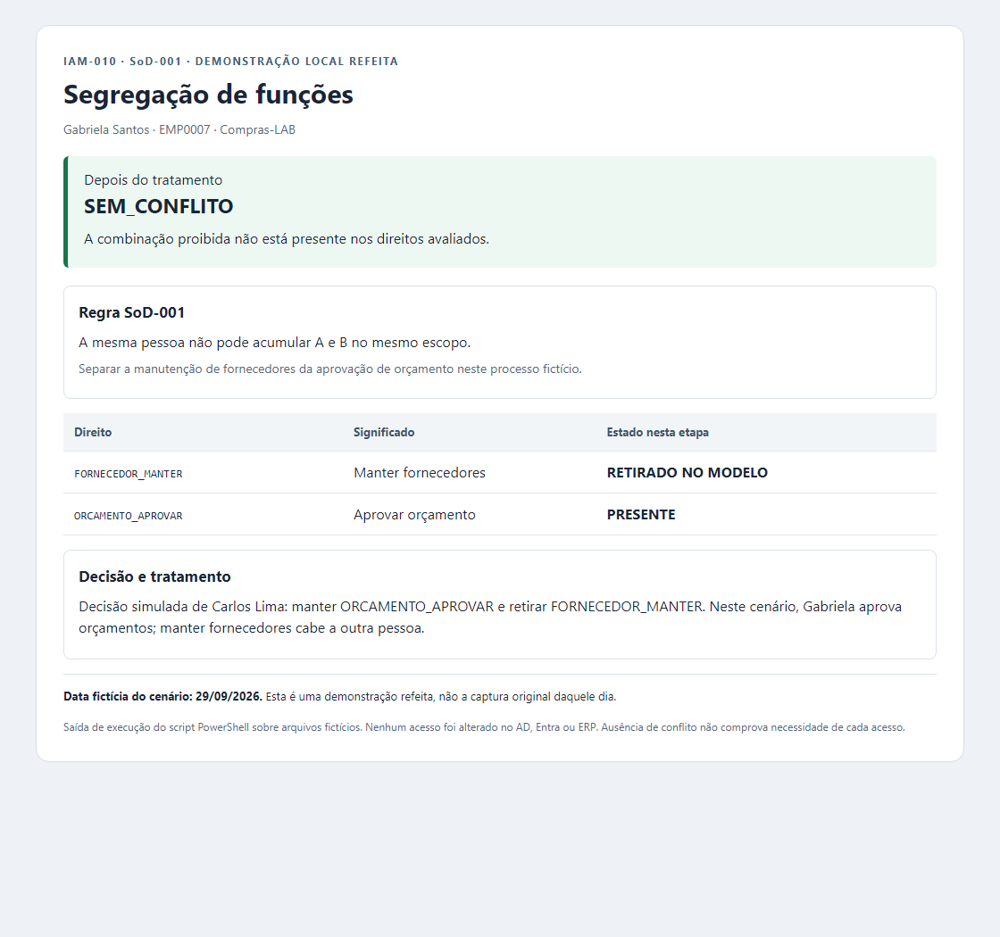

# SoD-001 — conflito tratado no modelo local

**Objetivo:** detectar e tratar uma combinação de direitos incompatíveis pela regra fictícia de Compras-LAB. Leia regra → conflito → decisão → resultado. As duas imagens são relatórios de uma **demonstração refeita**, com data fictícia do cenário de **29/09/2026**.

## 1. Regra e motivo da separação

**SoD significa segregação de funções. Regra SoD-001:** a mesma pessoa não pode acumular os direitos A e B no mesmo escopo de Compras-LAB.

| Direito fictício | Significado no processo |
|---|---|
| A — `FORNECEDOR_MANTER` | Manter o cadastro de fornecedores. |
| B — `ORCAMENTO_APROVAR` | Aprovar orçamento. |

**Por que existe conflito:** Gabriela poderia alterar o cadastro de fornecedores e também aprovar orçamento no mesmo processo. Essa concentração reduz a revisão independente e cria risco de favorecimento de um fornecedor ou de um erro passar sem conferência. A regra separa essas responsabilidades.

O achado é um **conflito de funções/permissões**, não prova de que Gabriela tenha interesse pessoal, cometeu fraude ou realizou pagamento. Os dois direitos, sozinhos, não demonstram capacidade de pagar fornecedores. A incompatibilidade foi definida para este cenário.

**Tratamento:** Gabriela (EMP0007) mantém a aprovação de orçamento e perde a manutenção de fornecedores no modelo. A manutenção deve ficar com outra pessoa; essa atribuição a outra identidade não foi implementada neste exercício.

## 2. Antes — detectar o conflito

O script lê os direitos de Gabriela no CSV fictício: manter fornecedores **e** aprovar orçamento no mesmo escopo. Resultado: **CONFLITO** pela SoD-001.

[Relatório estruturado — antes](sod-demonstracao/antes.json).

## 3. Decisão e resultado após o tratamento

**Decisão simulada atribuída a Carlos Lima:** manter B e retirar A, pois Gabriela aprova orçamentos no cenário e a manutenção de fornecedores cabe a outra pessoa. A atribuição dessa função a outra pessoa não foi implementada. A etapa Depois aplica a decisão somente aos dados em memória e avalia novamente:

**Validação:** somente B permanece; a contagem passa de um para zero conflitos. [Relatório estruturado — depois](sod-demonstracao/depois.json).

## 4. Como o script compara e quais são os limites

O [novo script PowerShell](../../../05-automacao/SoD-001/Invoke-SoDCase.ps1) lê **regra.json** (esperado), **acessos.csv** (observado fictício) e **decisao.json** (tratamento simulado). Confere pessoa, escopo, campos e duplicidades. A presença de A e B gera conflito; Depois retira A em memória, preserva B e compara novamente. Cada etapa exporta JSON e HTML; as imagens desta página são capturas desses HTMLs. [Entradas e reprodução](../../../05-automacao/SoD-001/README.md) · [arquivos da demonstração](sod-demonstracao/README.md).

Cada execução recria os dados. As provas demonstram detecção e tratamento no modelo local, sem revogação em aplicação real. SoD estática: sem ERP, transações financeiras, API de concessão, prevenção implantada ou avaliação de conluio. A decisão é simulada, sem aprovação corporativa externa. `GG_FIN_READ` não concede esses direitos, e **zero conflitos não comprova necessidade de cada acesso**.

[Voltar ao índice por assunto](README.md).
